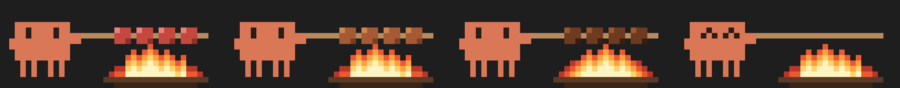

# Mishkak 🍢

A Claude Code mod: while Claude works, Clawd grills a skewer of **mishkak** above the prompt. The answer and the steps keep streaming as usual.

The 4 pieces of meat go from raw, to browned, to charred, and then Clawd eats them and starts again. The art hides itself when Claude finishes.



## Install

In Claude Code:

```text
/plugin install mishkak --marketplace wahaibi0/claude-mishkak
```

Answer `y` to add the marketplace, pick a scope, then run `/reload-plugins`.

It works in the terminal and in the Claude desktop app. In the terminal it needs a window at least 40 columns wide.

## Develop

```sh
claude --plugin-dir .      # run Claude Code with this folder's mod
claude plugin validate .
claude plugin test .
```

The art is drawn in code in `hooks/art.ts` (a 40×16 pixel grid, 48 frames of 250 ms). The desktop gets it as one animated SVG, and the terminal as half-block cells.
