<p align="center"></p>

# Mishkak 🍢

A Claude Code mod. While Claude works, Clawd grills **mishkak** by a campfire in the Omani dunes, right in the transcript under the streaming answer, where the spinner line is. The meat cooks from raw to charred, then Clawd eats it.

## Install

```text
/plugin install mishkak --marketplace wahaibi0/claude-mishkak
```

Answer `y`, pick a scope, then run `/reload-plugins`. Works in the terminal (60+ columns) and the desktop app.

## Develop

```sh
claude --plugin-dir .    # run with this mod
claude plugin test .
bun -e "import { svg } from './hooks/art.ts'; await Bun.write('preview.svg', svg(true, 7))"    # refresh the preview
```

The art is drawn in code in `hooks/art.ts`.
